<h1 align="center">
  
</h1>

<p align="center">
  <a href="#the-idea-in-30-seconds">The idea</a> ·
  <a href="#when-does-it-buy">The rule</a> ·
  <a href="#does-it-work">Does it work?</a> ·
  <a href="#safety-rails">Safety</a> ·
  <a href="#the-dashboard">Dashboard</a> ·
  <a href="#try-it">Try it</a> ·
  <a href="RESEARCH.md">Research notes</a>
</p>

**Lock-In is a trading bot for [Kalshi](https://kalshi.com), an exchange where people trade on yes-or-no questions.**

It trades one kind of question: *"Will Bitcoin be above this price 15 minutes from now?"* It does not try to predict Bitcoin. It waits for the last minute of each market, when the answer is almost settled, and buys the likely side only if that side is still cheaper than it should be.

> [!WARNING]
> This bot can trade real money, and it can lose it. Three days in (13 Oct 2026) its own trades with real money were about $8 down ([day one](#3-the-first-day-with-real-money), [day three](#4-day-three-the-market-moved-first)). Nothing here is financial advice.

---

## The idea in 30 seconds

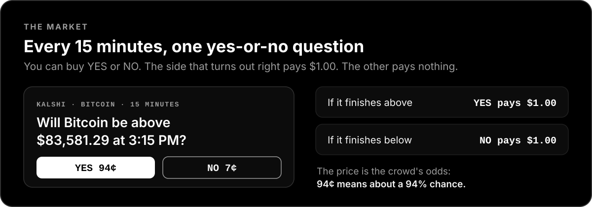

Every 15 minutes Kalshi opens a new Bitcoin market. You can buy **YES** or **NO** for somewhere between 1¢ and 99¢. When the market closes, the right side pays **$1** and the wrong side pays nothing.

The interesting part is how Kalshi decides the result:

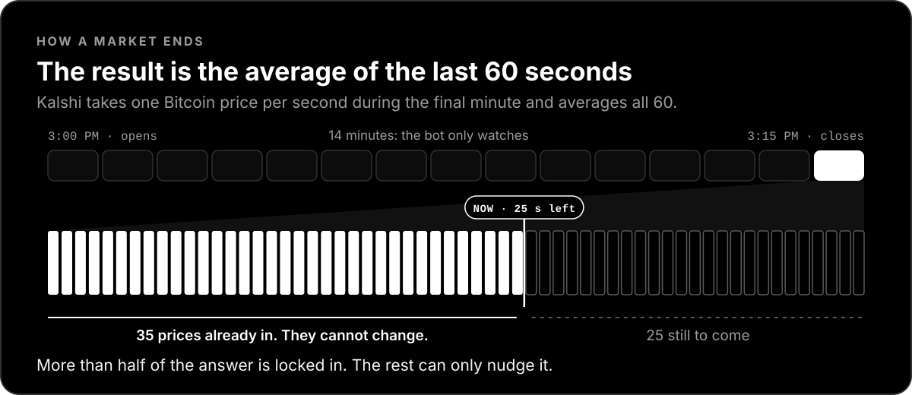

It does not use the last price. It uses the **average of 60 prices**, one per second, from the final minute. So as that minute ticks by, more and more of the answer is already fixed.

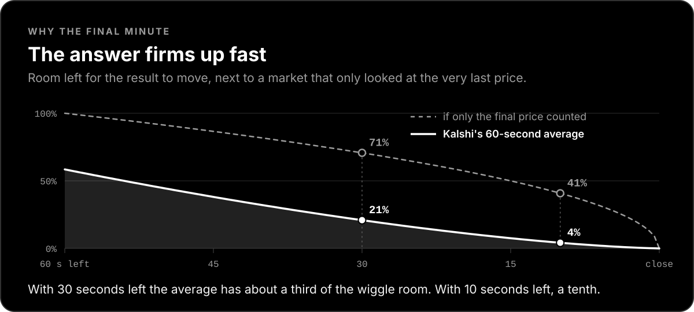

That is the whole idea. Late in the final minute one side is often close to certain, but its price has not always caught up. Lock-In reads each of those 60 prices as it arrives, works out the real odds, and buys when the near-certain side is on offer for less than it is worth. It holds for under a minute, then the market pays out.

## When does it buy?

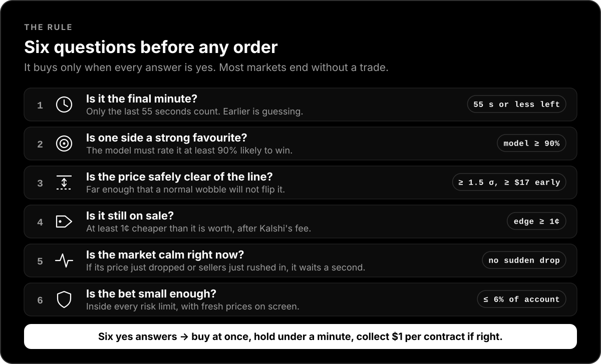

Most markets fail at least one check, and then the bot does nothing. In the replay below it traded about **one market in six**.

<details>
<summary><b>The exact rule, for the curious</b></summary>

<br>

- **Markets:** Kalshi's 15-minute Bitcoin markets (`KXBTC15M`) and the hourly Bitcoin price ladder (`KXBTCD`). Both settle on the average of the 60 one-second CF Benchmarks BRTI prints before the close.
- **Model:** the average is priced exactly. Prints already in are fixed, and only the remaining ones can move it. Volatility is measured live, and fat tails are handled with a Student-t distribution. The maths is checked against simulation in `tests/`.
- **Buy when:** the favourite is at least 90% likely, at least 1.5 standard deviations clear of the strike, and offered at least 1¢ below fair value after Kalshi's fee.
- **15-minute markets only:** act in the final 55 seconds, and while more than 45 seconds remain the expected result must be at least 2 basis points (about $17) from the strike. The hourly markets use the full 60 seconds.
- **Wait when the market moved first:** Kalshi's traders react to a jump in Bitcoin up to a second before the index shows it. If the side the bot wants traded, or was bid, more than 10¢ higher within the last second, or more of it was sold in the last half second than normally trades in a whole second, the bot holds off and looks again a second later.
- **Orders:** immediate-or-cancel at a capped price, then held to settlement.
- **Other coins:** the engine can run ETH, SOL, XRP and DOGE, but only Bitcoin passed the tests, so the others are off by default.

Every number and how it was measured: [RESEARCH.md](RESEARCH.md).

</details>

## Does it work?

**On past markets: yes. With real money: too early to say.** Here is the evidence for both, including the bad days.

### 1. Replayed on past markets

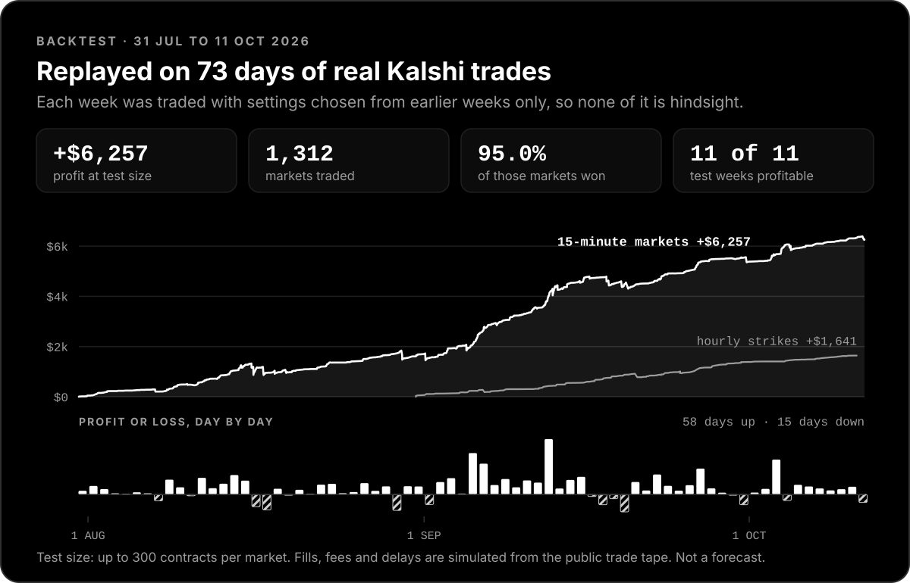

| | 15-minute markets | Hourly markets |
|---|---|---|
| Period | 31 Jul – 11 Oct 2026 | 31 Aug – 11 Oct 2026 |
| Markets traded | 1,312 | 240 |
| Markets won | 95.0% | 97.1% |
| Profit after fees, at test size | **+$6,257** | **+$1,641** |
| Profit per contract | +3.4¢ | +5.6¢ |
| Weeks in profit | 11 of 11 | 6 of 6 |
| Days in profit | 58 of 73 | 37 of 40 |
| Deepest dip along the way | $486 | $139 |

What keeps the replay honest:

- **Real trades only.** An order counts as filled only if a real trade happened at that price right afterwards, and only for half of that trade's size.
- **Delays and fees are in.** A quarter of a second passes between deciding and buying, and Kalshi's fee is charged on every purchase.
- **No hindsight.** The settings for each week were chosen from earlier weeks only.
- **Tested on unseen data.** The first version was frozen on 27 Sep 2026, then run unchanged on the two weeks that followed: 124 markets traded, 91.9% won, **+$717**.

> [!NOTE]
> "Test size" means up to 300 contracts per market, roughly $280 at a time. A $100 account trades the same signals at about $6 each, so its dollar results are far smaller. A replay is also kinder than real life: it cannot know how other traders would have reacted to the bot's orders.

### 2. The catch: small wins, big losses

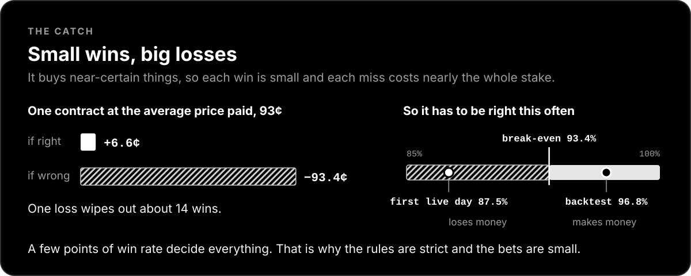

Buying a near-certain thing for 93¢ earns about 6½¢ when it works and loses about 93¢ when it does not. **One loss wipes out about 14 wins.** The bot has to be right more than 93.4% of the time just to break even. In the replay it was right 96.8% of the time. That gap is the entire profit, and it is thin. (The sharper replay in [section 4](#4-day-three-the-market-moved-first) puts it nearer 96% for the old rule and 97% with the newest check.)

### 3. The first day with real money

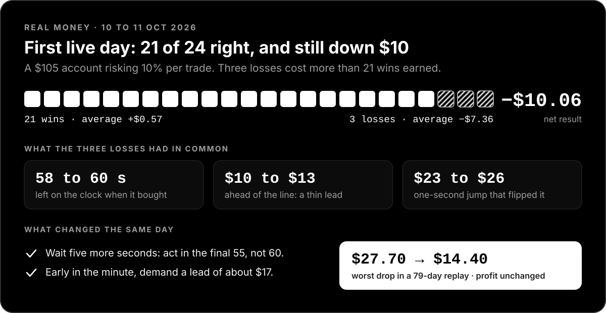

The bot went live on 10 Oct 2026 with about $100. In its first 18 hours it won 21 of 24 trades and was still **down $10.06**, because three losses cost more than 21 wins earned.

All three losses looked the same: bought at the earliest moment allowed, with a small lead, and then Bitcoin jumped about $25 in a single second. A replay of those same hours shows the same three losing markets, so this was the strategy's known weak spot and not a malfunction.

The rule was tightened the same day: wait five more seconds, and demand a bigger lead early in the minute. Over the 79 days before going live, that change kept the profit and roughly halved the worst dip.

One day proves nothing either way. It is the reason the bets are small.

### 4. Day three: the market moved first

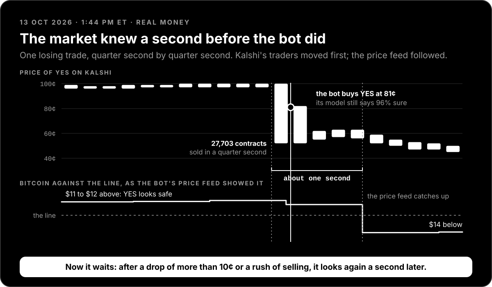

After that change the bot made 27 trades in two days: 24 right, 3 wrong, **$5.74 down**. Two of the three losses had the same cause, and it was not the one from day one.

When Bitcoin jumps, traders on Kalshi react within a fraction of a second. The official price the bot reads shows the jump up to a second later. In that gap the bot still believed in the old favourite, saw its price collapse, and bought what looked like a bargain. The picture above is one of those trades.

It also exposed a blind spot in the replay from section 1. That replay looks at each market once a second. The live bot looks ten times a second, so about a third of what it really does never showed up there. A second replay now runs the live code over every recorded trade. It reproduces 26 of the bot's 27 real trades since the rule change, including all three losses, and its verdict on the old rule is less flattering: **4.1% of trades lost, not 2.8%**, and a worst dip of **$34 on a $100 account, not $14**.

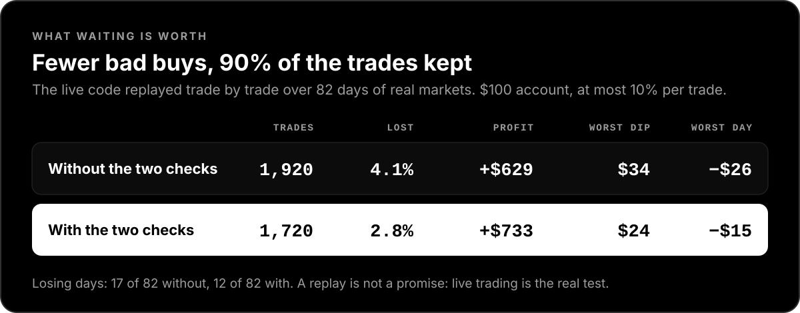

So the bot got a sixth question: *is the market calm right now?* If the side it wants has just dropped more than 10¢, or sellers have just rushed in, it waits a second and looks again. In the sharper replay that keeps 90% of the trades and removes about four in ten of the losing ones. Nearly all of the gain comes from some 30 markets where the old rule bought the collapsing side and the new rule ends up on the side that won.

The first evening showed it at work. At 6:59 PM ET Bitcoin dropped $20 in one second, to just under the line. The old rule would have bought NO at about 60¢ and lost. The bot waited, Bitcoin bounced back, and fifteen seconds later it bought YES at 73¢ and won $2.82.

The third loss was a milder case of the same thing, and the new check, as set, would not have stopped it: sellers had rushed in half a second earlier, but just under the threshold. A second later the market itself was paying 98¢ for YES again, and then Bitcoin fell another $29. A slightly stricter setting would have kept the bot out, though over the whole history the two settings are hard to tell apart. Some of this is simply the risk from section 2.

### 5. Stress tests and calibration

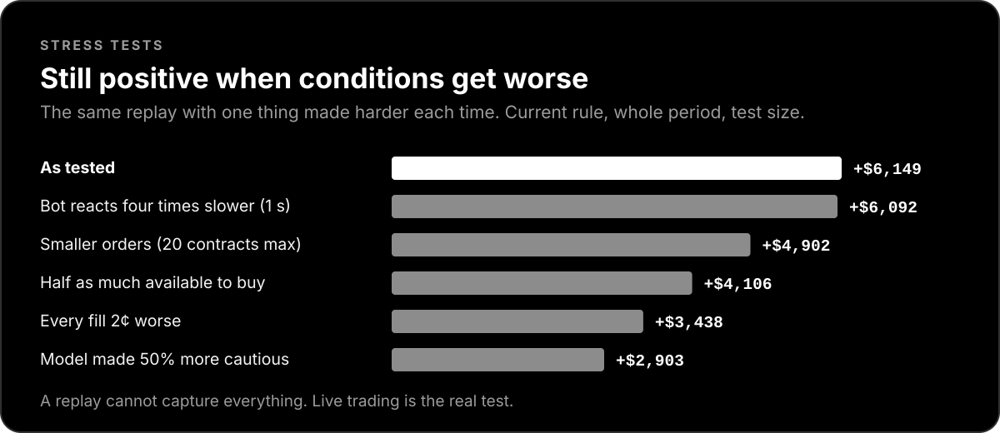

The replay made harder on purpose: slower reactions, worse prices, less to buy. Profit shrinks and stays positive.

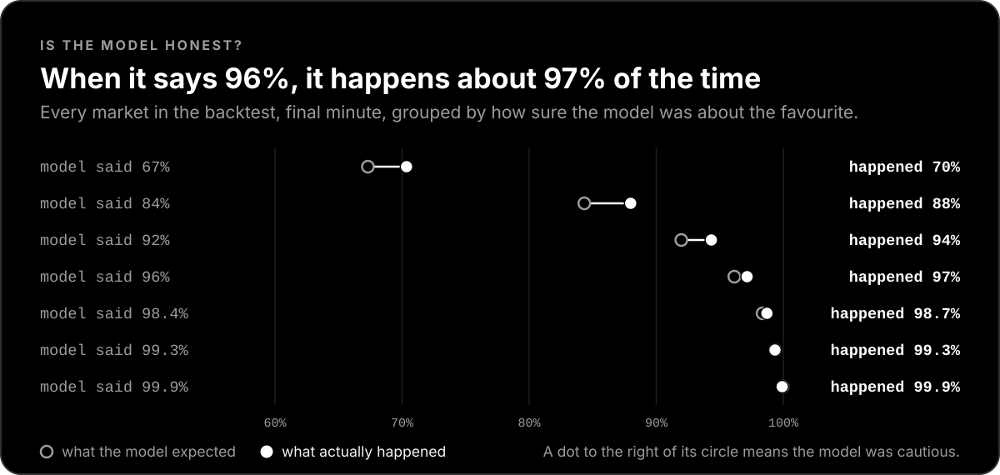

Can the model's confidence be trusted? When it said 96%, the favourite won about 97% of the time. It leans slightly cautious across the board.

### What can still go wrong

- **Sudden jumps.** A sharp move in the last few seconds turns a "sure thing" into a full loss. This is the main risk.
- **The market can know first.** Other traders see a move before the bot's price feed does. The newest check catches the obvious cases, not all of them.
- **The edge can fade.** It exists because some traders misprice the average. As more of them get it right, there is less to earn.
- **Real fills can be worse** than the replay assumes, especially for bigger accounts.
- **Replays can be too kind.** The first one was: it missed a third of the bot's trades. The sharper one still has to assume how much the bot could have bought, and nobody can check that in advance.
- **Recent days were harder.** Three losses in the last 27 real trades is about 11%, against roughly 4% in the replay of the same rule.
- **Software and connections fail.** The safety rails below limit the damage. They do not remove it.

## Safety rails

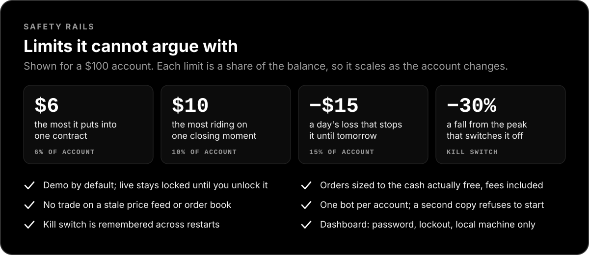

Every limit is a setting, and each has a hard dollar cap on top. The bot starts in **Demo** mode with fake money. Real trading stays locked until you unlock it on purpose by typing a confirmation phrase.

<details>
<summary><b>See the settings screen</b></summary>

<br>

<p align="center">
  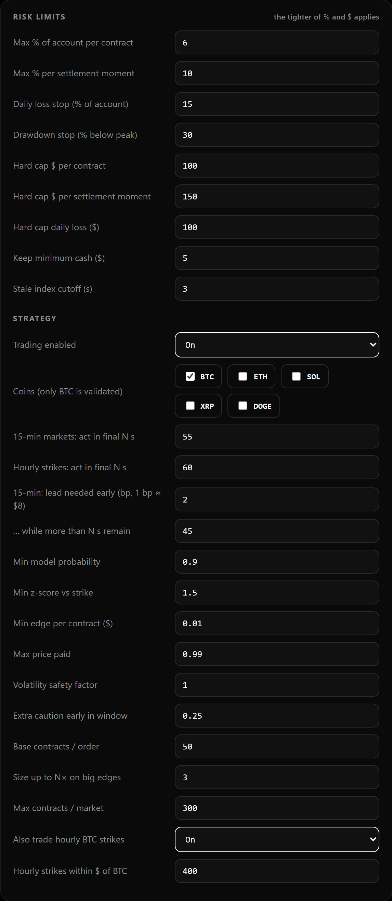
</p>

</details>

## The dashboard

A black-and-white control room that runs in your browser.

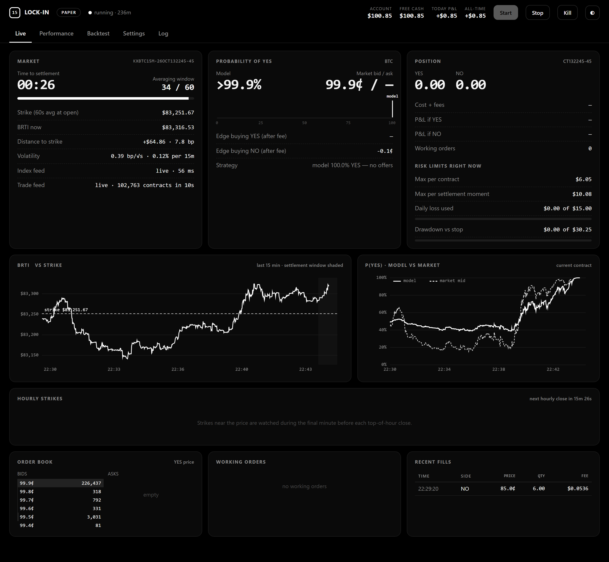

<p align="center"><sub>The Live tab in Paper mode: real Kalshi prices, a pretend $100 account.</sub></p>

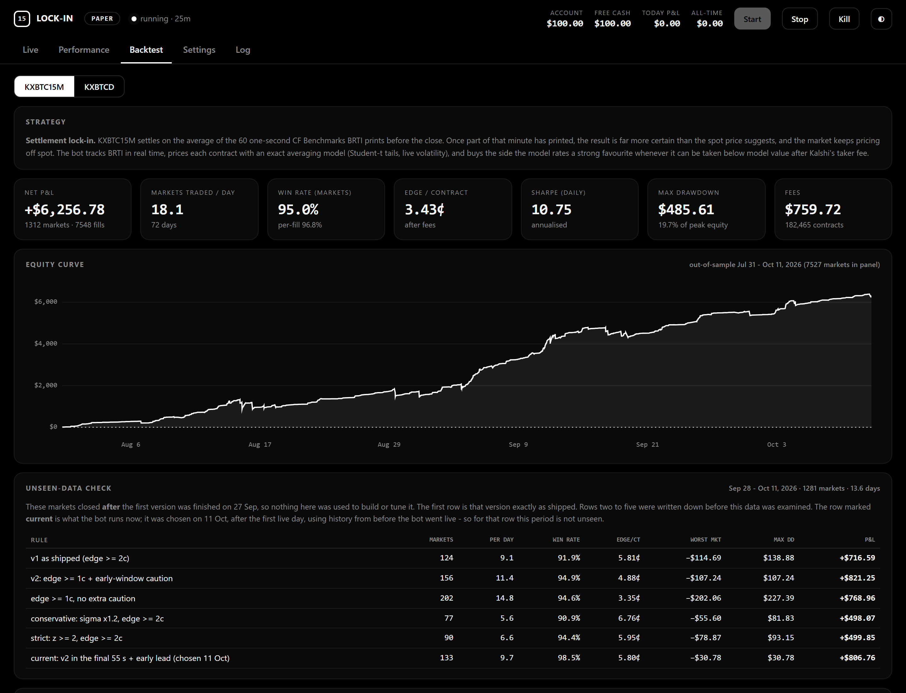

<p align="center"><sub>The Backtest tab: the replay results above, straight from the research code.</sub></p>

- **Live:** the countdown, the model's odds next to the market's price, your position, your limits, and whether the trade feed is live.
- **Performance:** every trade and the running profit or loss.
- **Backtest:** the research results, so you can see what the rules did on past markets.
- **Settings:** mode, API key, limits and strategy numbers, plus a readiness check that never places an order.
- **Start, Stop, Kill:** Stop cancels open orders. Kill cancels everything and blocks trading until you release it.

## Try it

You need Python 3.12 or newer and a Kalshi account to create an API key.

```bash
git clone https://github.com/yusufbadar/KalshiBTCPredictionModel15.git
cd KalshiBTCPredictionModel15
pip install -r requirements.txt
python -m kalshi_bot
```

Then open **http://127.0.0.1:8000** and:

1. Go to **Settings**, choose a mode, paste your API key ID and private key, and press **Save**.
2. Press **Run readiness check**. It tests the login, the price feed and your limits.
3. Press **Start**.

| Mode | Money | Prices | Good for |
|---|---|---|---|
| **Paper** | pretend ($100 by default) | real Kalshi prices | watching the strategy work. Start here. |
| **Demo** | Kalshi's fake-money exchange | made-up test prices | checking that orders and limits behave |
| **Live** | real | real | only after you unlock it on purpose |

> [!NOTE]
> Profit or loss in **Demo** means nothing. Kalshi's demo exchange is filled by test bots at random prices, and its results do not match the real exchange. Use Paper to judge the strategy.

<details>
<summary><b>Going live with real money</b></summary>

<br>

1. Create an API key on Kalshi's real exchange and fund the account.
2. In **Settings** choose **Live**, type the phrase `TRADE REAL MONEY`, paste the production key ID and private key, and press **Save**. Demo and production keys are stored separately.
3. Press **Run readiness check**. Every line should say OK.
4. Press **Start**. Run only one copy of the bot per Kalshi account.

Start small. With the default limits a $100 account puts at most $6 into one contract.

</details>

<details>
<summary><b>Without the dashboard</b></summary>

<br>

```bash
python -m kalshi_bot.cli --env paper     # run in a terminal, Ctrl+C to stop
python -m kalshi_bot.preflight           # readiness check only
python -m pytest -q tests                # 119 tests
```

</details>

### Running it around the clock

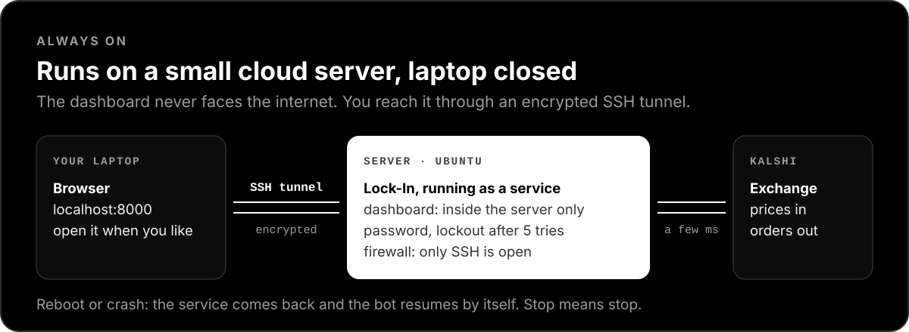

The bot has to stay switched on, so it lives best on a small Linux server for a few dollars a month. Serverless hosts such as Vercel cannot keep a program running, so they do not work. One script installs everything, and the dashboard stays private behind an SSH tunnel and a password.

<p align="center">
  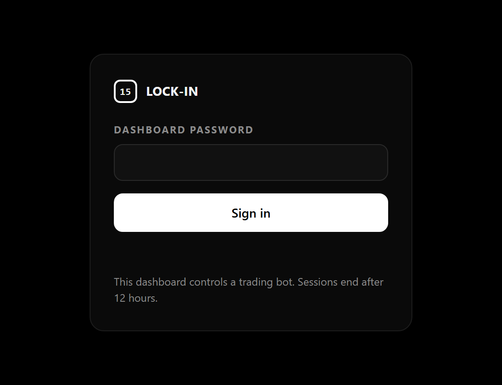
</p>

Step-by-step guide: [deploy/README.md](deploy/README.md).

## How it is built

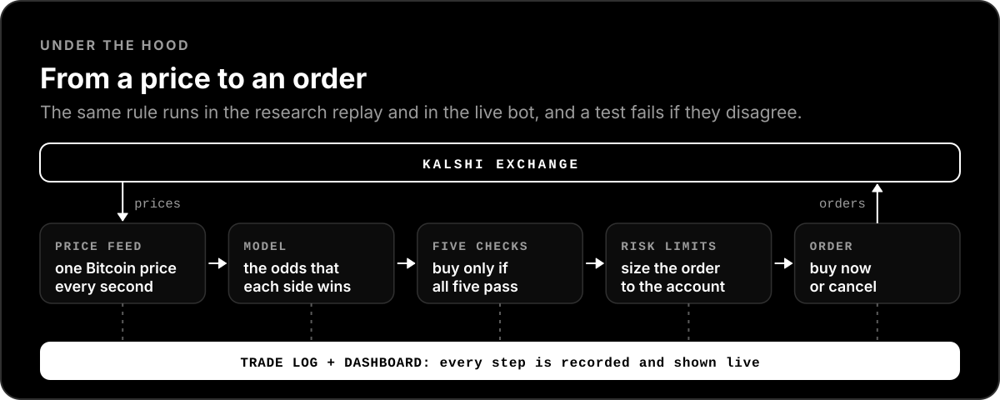

The research code and the live bot share one rule. A test replays the backtest's own trades through the live strategy and fails unless at least 99% of them match.

<details>
<summary><b>Project layout</b></summary>

<br>

```
kalshi_bot/
  api/          request signing, REST and WebSocket clients
  core/         order book, price index and clock, public trade tape, markets, orders,
                risk limits, trade ledger, paper broker, one-bot-per-account lock
  model/        fair value of the 60-second average, live volatility
  strategy/     the lock-in rule
  research/     data download, backtester, walk-forward report, unseen-data check,
                small-account simulation, trade-by-trade replay of the live code
  web/          dashboard server, login, the two HTML pages
  engine.py     the live trading loop        cli.py   terminal runner
  preflight.py  read-only readiness check
deploy/         server install: service file, setup script, bundle builder, guide
docs/           pictures in this README and the script that draws them
tests/          pricing, accounting, risk, login, dashboard and engine tests
legacy/         the original candle-pattern bot, kept for reference
```

</details>

<details>
<summary><b>Reproduce the numbers</b></summary>

<br>

Everything is measured on Kalshi's public trade data, which the first command downloads.

```bash
python -m kalshi_bot.research.history --days 14 --tail-seconds 130            # newest 15-minute markets
python -m kalshi_bot.research.history --series KXBTCD --days 14 --min-volume 20000 --tail-seconds 130
python -m kalshi_bot.research.report --series KXBTC15M     # walk-forward + unseen-data check
python -m kalshi_bot.research.report --series KXBTCD
python -m kalshi_bot.research.holdout                      # fixed rules on markets after the freeze
python -m kalshi_bot.research.account                      # what it means for a $100 account
python -m kalshi_bot.research.tape_replay --per-market 0.10 --per-close 0.15   # the live code, trade by trade
python docs/make_figures.py                                # redraw the charts in this README
```

</details>

## The story so far

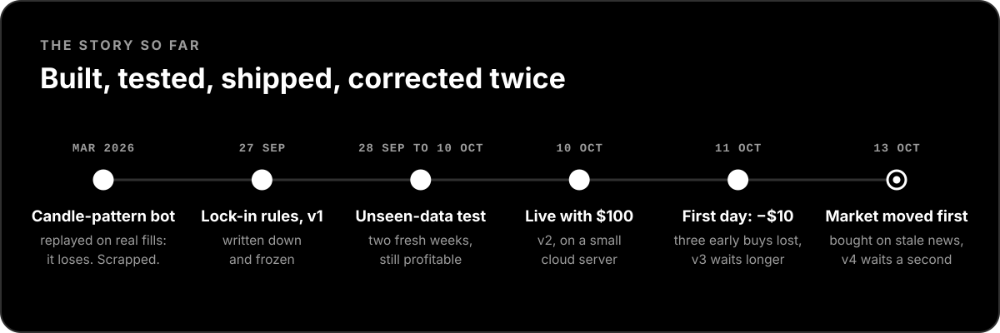

Ideas that were tested and thrown out:

| Idea | What happened |
|---|---|
| Predicting the next move from price candles (the original bot) | Lost 1.2¢ per contract once real prices and fees were counted |
| Buying before the final minute | Lost about 6¢ per contract, even when the model was very confident |
| Leaving orders in the book and waiting to be filled | Filled mostly when it was wrong |
| Betting on favourites in general | Too weak to tell apart from luck |
| The same rule on Ethereum and XRP | Break-even or inconsistent, so they stay off |
| Looser entry rules, to trade more often | More trades, and dips twice as deep |
| Switching off the hourly markets after a loss there | Gives up about a fifth of the profit, and the dips are no smaller |
| Stricter entry: a surer model, a bigger discount, a lower price cap | Fewer trades, and about as many losses |

## Words used here

| Word | Meaning |
|---|---|
| **Contract** | One YES or NO ticket. It costs 1¢ to 99¢ and pays $1 if it is right. |
| **The line** (strike) | The price Bitcoin has to finish above for YES to win. |
| **Settlement** | The moment Kalshi decides the result and pays out. |
| **Index** | The Bitcoin price Kalshi settles on (CF Benchmarks BRTI), published once a second. |
| **Trade tape** | The public list of every trade in a market, as it happens. |
| **Edge** | How much cheaper a contract is than it should be, after fees. |
| **Replay** (backtest) | Running the rules over past markets to see what would have happened. |
| **Paper trading** | Pretend trades against real prices. |
| **Dip** (drawdown) | The fall from the account's highest point to a later low. |
| **Kill switch** | A stop that cancels everything and stays on until a person releases it. |

## Disclaimer

This is software for research and education. Trading on prediction markets carries a real risk of loss, including the whole stake on any contract. Backtests and simulations are not guarantees, and live results can be worse. Nothing here is investment advice. Only trade money you can afford to lose.
